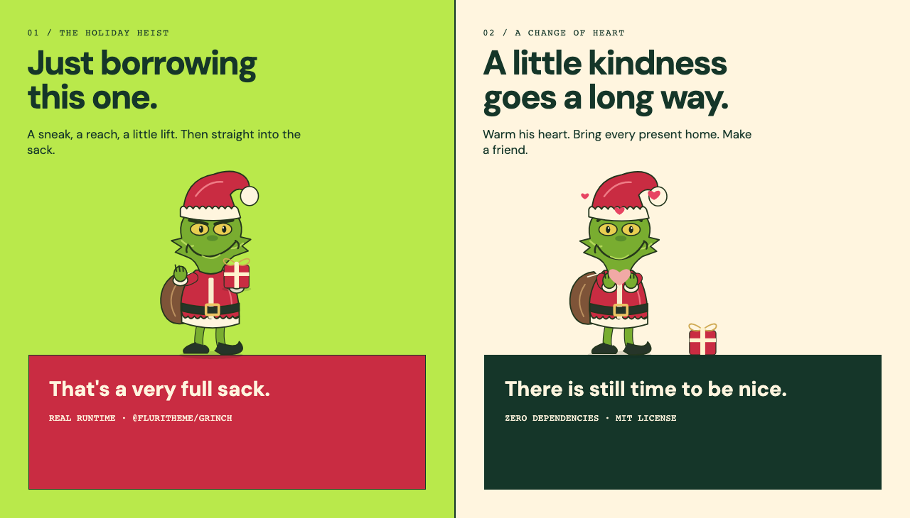

<div align="center">

# Grinch by Fluri

**A little green. A little greed. A lot of personality.**

A mischievous holiday visitor who sneaks around your website, steals presents, hides behind cards, and discovers a softer side of Christmas.

[](https://www.npmjs.com/package/@fluritheme/grinch)
[](https://www.npmjs.com/package/@fluritheme/grinch)
[](https://github.com/fluritheme/grinch/actions/workflows/ci.yml)
[](./LICENSE)

[Live playground](https://grinch.fluri.xyz/) · [All Fluri themes](https://fluri.xyz/) · [npm](https://www.npmjs.com/package/@fluritheme/grinch) · [JSR](https://jsr.io/@fluritheme/grinch)


</div>

## Meet your website's least innocent resident

- **An actual little heist.** He approaches a present, reaches for it, lifts it, and puts it in his sack. Presents stay on their ledges until he picks them up.
- **Real places to hide.** He ducks behind page objects, peeks out, then climbs back onto a ledge. The sack gets fuller with every successful theft.
- **Catch him in the act.** Move the pointer close or tap him to startle him. A stolen present flies back to its original element.
- **A change of heart.** Kindness mode warms his heart, returns the entire sack, and turns him into a friendly visitor.
- **A proper entrance.** Sneak in from the side, descend on a white rope, or appear immediately.
- **Your content stays yours.** Presents are illustrated props. Buttons, images, text and links are never stolen or rearranged.
- **Small and considerate.** Zero runtime dependencies, no runtime network requests, bounded gift count, one Canvas, reduced-motion support, pause/resume and complete cleanup.



These previews come from the running package. The character and presents are original procedural vector artwork, rendered in Canvas.

## Install

```sh
npm i @fluritheme/grinch
```

```ts
import { createGrinch } from '@fluritheme/grinch';

const visitor = createGrinch({
  targets: '[data-grinch-gift]',
});

// When the page unmounts:
visitor.destroy();
```

Mark a few elements with room above them for a tiny visitor and a present:

```html
<article data-grinch-gift data-grinch-object>A little room for holiday mischief.</article>
```

Without `targets`, the package uses `[data-grinch-gift]` elements first, then common cards and buttons. Use `[data-grinch-ignore]` on an element or ancestor to exclude it. `data-grinch-object` marks objects he can hide behind; the default object selector also recognizes cards, images, articles and buttons.

## Try a different ending

```ts
visitor.steal(); // Start a heist when he is ready
visitor.steal('#special-card'); // Choose a tracked gift
visitor.shoo(); // Catch him and return one present
visitor.returnGifts(); // Return the sack along animated arcs
visitor.redeem(); // Return everything; switch to friendly
visitor.wave(); // Say hello

visitor.update({ size: 1.2, speed: 0.8, fearRadius: 120 });
visitor.update({ mood: 'mischievous' }); // Allow mischief again
visitor.pause();
visitor.resume();
visitor.refresh(); // Request a layout measurement
```

`steal()` returns `false` while he is busy, paused, in friendly mode, or respecting reduced motion. A selector must match a gift already tracked by this instance. Calls do not queue extra thefts.

## React / Next.js

Create the visitor after mounting, and return its cleanup. For Next.js, use a client component.

```tsx
'use client';

import { useEffect } from 'react';
import { createGrinch } from '@fluritheme/grinch';

export function HolidayVisitor() {
  useEffect(() => {
    const visitor = createGrinch({ targets: '[data-grinch-gift]' });
    return () => visitor.destroy();
  }, []);

  return <article data-grinch-gift>Your holiday card</article>;
}
```

## Vue

```vue
<script setup lang="ts">
import { onMounted, onUnmounted } from 'vue';
import { createGrinch, type GrinchController } from '@fluritheme/grinch';

let visitor: GrinchController | undefined;
onMounted(() => {
  visitor = createGrinch();
});
onUnmounted(() => visitor?.destroy());
</script>

<template>
  <article data-grinch-gift>Your holiday card</article>
</template>
```

## Keep him inside a section

```ts
const root = document.querySelector<HTMLElement>('#holiday-section')!;
const visitor = createGrinch({ root, territory: 'root' });
```

This clips the scene to the root's rectangle and selects gifts from inside it. The default `territory: 'page'` allows movement around the document. Coordinates are anchored to the document, so scrolling does not attach the visitor to your viewport. Nested scrolling and moving gift anchors are measured too.

## Options

| Option        | Default               | Purpose                                  |
| ------------- | --------------------- | ---------------------------------------- |
| `root`        | `document`            | Element to search for gifts              |
| `targets`     | Automatic             | CSS selector or array of elements        |
| `territory`   | `'page'`              | `'page'` or `'root'`                     |
| `objects`     | Common cards/elements | Selector for objects he can hide behind  |
| `maxGifts`    | `5`                   | Maximum tracked presents, 1–12           |
| `size`        | `1`                   | Character and present scale, 0.6–1.8     |
| `mobileScale` | `0.85`                | Additional scale below 600px, 0.6–1      |
| `speed`       | `1`                   | Movement multiplier, 0.25–2              |
| `cooldown`    | `10`                  | Seconds between completed heists, 3–120  |
| `fearRadius`  | `90`                  | Pointer reaction radius; `0` disables it |
| `mood`        | `'mischievous'`       | Or `'friendly'` for a gentler visitor    |
| `autoSteal`   | `true`                | Start heists automatically               |
| `entrance`    | `'sneak'`             | `'sneak'`, `'rope'`, or `'appear'`       |
| `motion`      | `'system'`            | `'system'`, `'full'`, or `'none'`        |
| `observe`     | `true`                | Observe layout and content changes       |
| `zIndex`      | `140`                 | Canvas stacking position                 |
| `furColor`    | `'#79ad30'`           | Six-digit hex color                      |
| `coatColor`   | `'#c92c42'`           | Six-digit hex color                      |
| `controls`    | `false`               | Add an accessible visitor pause button   |

`update()` accepts size, mobileScale, speed, cooldown, fearRadius, mood, autoSteal, furColor and coatColor. Configuration is validated before mounting; invalid values throw. The palette stays stable when he crosses dark or light content.

## Events and state

```ts
const stop = visitor.on('gift:stolen', ({ giftId, totalStolen }) => {
  console.log(giftId, totalStolen);
});

visitor.on('redeemed', () => console.log('A little kindness wins.'));
const snapshot = visitor.getState();
console.log(snapshot.phase, snapshot.stolen, snapshot.gifts);
stop();
```

Events: `ready`, `phase`, `theft:start`, `gift:stolen`, `gift:returned`, `caught`, `redeemed`, `error`. `getState()` returns a copy with lifecycle, mood, phase, character coordinates, gift states, current stolen count, lifetime total and caught count. Coordinates are CSS pixels in the document; character coordinates describe his feet.

## Motion, rendering and layout

The default respects `prefers-reduced-motion`: a still resident, no automatic thefts. Hidden tabs stop animation. `pause()` freezes the routine while retaining layout measurements; `destroy()` removes the Canvas, controls, observers, event listeners and animation loop. Importing on the server is safe and does not create a browser instance.

The Canvas ignores pointer events, so website controls remain clickable. Hosts can provide keyboard-accessible buttons calling `shoo()`, `redeem()` and `pause()`, as the playground does. Hiding uses the visible rectangles, rounded corners and 2D transforms of matching objects. It approximates browser stacking rather than reproducing arbitrary CSS masks, 3D transforms, shadow DOM or every stacking context. Give the character roughly 145 × `size` pixels of room above a ledge. Targets need a visible box at least 48px wide.

Grinch can coexist with [Winter](https://winter.fluri.xyz/) or [Spider](https://spider.fluri.xyz/); each has its own controller. Keep active effects and gift counts modest on smaller devices.

## Develop

Node.js 22.12+ and pnpm 10.

```sh
pnpm install --frozen-lockfile
pnpm exec playwright install --with-deps
pnpm check
pnpm dev
```

The suite covers the heist and return state machine, configuration, SSR, cleanup, scrolling, mobile layout, host interactions and reduced motion across Chromium, Firefox, WebKit and iPhone-sized WebKit.

MIT. Built by [František Gejdoš](https://fluri.xyz/founder/), founder of [Fluri](https://fluri.xyz/).
